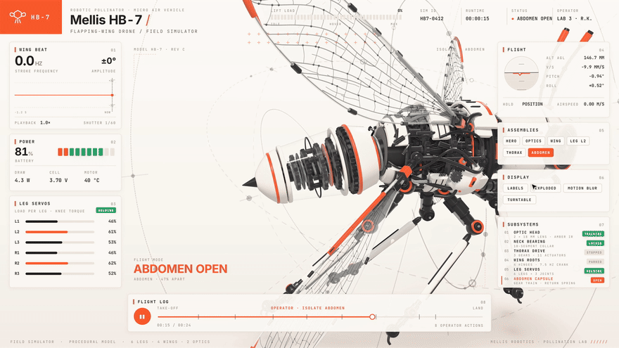
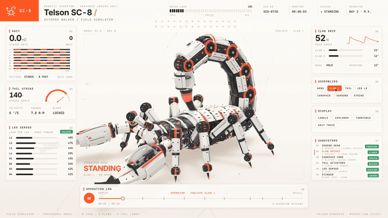
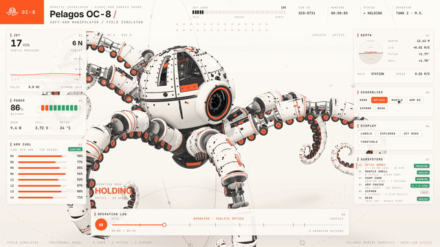

# MechViz — 3D Machine Simulator & Explainer Engine

An interactive 3D engineering simulator and explainer engine that transforms any machine or mechanical mechanism into a fully interactive 3D simulator you can take apart — all packed into a single zero-dependency offline HTML page.

- 🌐 **Live Web Portal**: [https://3d-machine-simulator.vercel.app](https://3d-machine-simulator.vercel.app)
- 📂 **GitHub Repository**: [https://github.com/TheSamsAlif/3d_Machine_Simulator](https://github.com/TheSamsAlif/3d_Machine_Simulator)

Ask how something works. MechViz builds it as one offline HTML page: the machine runs in the center driven by real kinematic equations, every instrument panel reads real numbers, a button opens the parts doing the work, and when nobody touches it the page tours itself.



| Telson SC-8 robotic scorpion | Pelagos OC-8 robotic octopus |
|---|---|
|  |  |

---

## 🎮 Interactive Simulators Live Showcase

| Machine Model | Subsystem & Kinematics | Live Simulator |
|---|---|---|
| **Mellis HB-7** | Robotic Pollinator MAV · 7.5 Hz Resonant Crank Flapping, 10-Segment Neck Bearing, 6-Leg Tripod Stance, Abdomen Spring Capsule | [🚀 Launch HB-7](https://3d-machine-simulator.vercel.app/bee-live.html) |
| **Pelagos OC-8** | Subsea Drone · 8 Articulated Continuum Tentacle Chains (282 Links, 489 Suction Wheels), 6-Petal Blossoming Mantle, 7-Piston Reactor Core | [🚀 Launch OC-8](https://3d-machine-simulator.vercel.app/octopus-live.html) |
| **Telson SC-8** | Bionic Octopod Walker · 5-Tier Dorsal Carapace Plates, Dual Hydraulic Chelae Claws with Glass Canopies, 5-Link Arched Strike Tail | [🚀 Launch SC-8](https://3d-machine-simulator.vercel.app/scorpion-live.html) |
| **V8 Four-Stroke** | Cross-Plane Counterweighted Crankshaft, 8 Pistons, Dual Overhead Camshafts, 16 Valves, Stencil Cutaway | [🚀 Launch V8](https://3d-machine-simulator.vercel.app/v8-live.html) |
| **Cessna 337 Gear** | Retractable Landing Gear, 32-Tooth Pinion Rack Stroke (201 mm), Over-Center Mechanical Dead-Lock Pin | [🚀 Launch Cessna](https://3d-machine-simulator.vercel.app/cessna-live.html) |
| **Strandbeest** | Theo Jansen 11-Bar Linkage Circle Intersection Solver, 20 Phased Walking Legs with Ground Contact Wave | [🚀 Launch Strandbeest](https://3d-machine-simulator.vercel.app/strandbeest-live.html) |

---

## Install

```bash
git clone https://github.com/TheSamsAlif/3d_Machine_Simulator.git
cd 3d_Machine_Simulator
npm install && npx playwright install chromium
```

You need Node.js 20 or newer. For video recording you also need `ffmpeg`, and for procedural sound Python 3.

## Use

Ask your AI coding assistant in plain words:

> Build me a simulator of a 4-stroke motorcycle engine I can take apart.

> How does a mechanical watch keep time? Show me as a simulator.

> Make a visual explainer of a hydraulic excavator arm and record a 20-second video.

Or bundle one of the 6 simulators locally:

```bash
node sims/build.mjs v8-live            # V8 Engine
node sims/build.mjs cessna-live        # Cessna Landing Gear
node sims/build.mjs strandbeest-live   # Strandbeest Walker
node sims/build.mjs bee-live           # Mellis HB-7 Robotic Bee
node sims/build.mjs octopus-live       # Pelagos OC-8 Robotic Octopus
node sims/build.mjs scorpion-live      # Telson SC-8 Robotic Scorpion
```

Or build all machines and portal together:

```bash
npm run build
```

## What is inside

| Directory / File | Description |
|---|---|
| `SKILL.md` | The AI engineering blueprint: how mechanisms are mathematically modelled, visual styling rules, review loops. |
| `sims/kit/` | Core WebGL runtime engine, Three.js studio stage setup, shader pre-compilation. |
| `sims/v8-*`, `sims/cessna-*`, `sims/strandbeest-*` | Classic mechanical engineering machines with dual `-live` (interactive) and `-film` (cinematic tour) modes. |
| `sims/bee-live`, `sims/octopus-live`, `sims/scorpion-live` | High-fidelity biomimetic and robotic simulators (Mellis HB-7, Pelagos OC-8, Telson SC-8). |
| `sims/build.mjs` | High-speed esbuild compiler bundling each machine into a self-contained single HTML file with inlined assets. |
| `portal/` | Interactive showcase web application featuring all 6 simulators with live telemetry and fullscreen view. |
| `docs/` | Showcase animations and GIFs (`bee.gif`, `octopus.gif`, `scorpion.gif`). |
| `sims/capture.mjs` | Playwright frame-by-frame renderer producing studio-grade 60 fps MP4 videos. |
| `sfx/`, `run_sfx.py` | Procedural timeline-synced audio synthesizer mastered to −14 LUFS. |

## License

MIT — [TheSamsAlif](https://github.com/TheSamsAlif)
